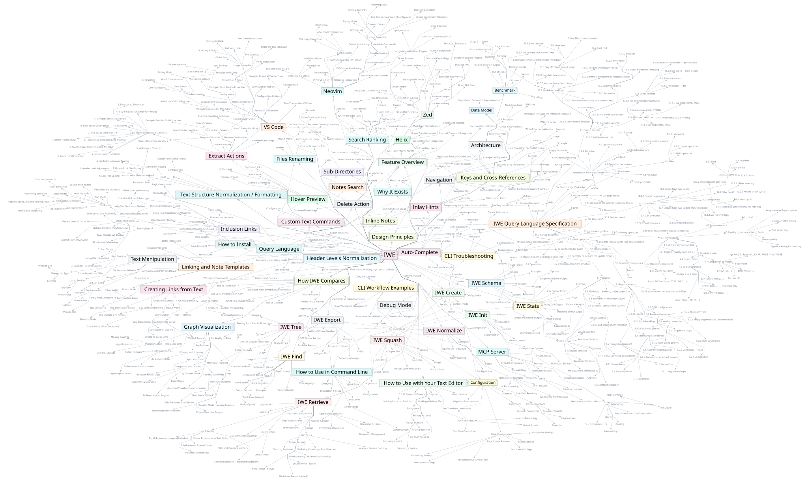

# IWE: ein Markdown-Wissensgraph für dich und deine KI-Agenten

IWE macht aus einem Ordner mit Markdown-Dateien einen Wissensgraphen. Du durchsuchst und refaktorierst ihn in deinem Editor über einen LSP-Server, und dein KI-Agent fragt ihn über eine CLI und einen MCP-Server ab. Dieselben Dateien, dieselben Links. IWE ist in Rust geschrieben und braucht keine Datenbank, keine Cloud und kein Konto.

Es ist für Leute, die datenbankartige Abfragen auf ihren Notizen wollen – „alle Entwürfe unter diesem Teilbaum“, „jede angenommene Entscheidung im ersten Quartal“ –, ohne sie in eine echte Datenbank zu verschieben.

[](https://github.com/iwe-org/iwe/stargazers)
[](https://crates.io/crates/iwe)
[](https://crates.io/crates/iwe)
[](https://github.com/iwe-org/iwe/blob/master/LICENSE-APACHE)

[Schnellstart](#schnellstart) · [So funktioniert es](#so-funktioniert-es) · [Editor](#in-deinem-editor) · [CLI](#cli) · [KI-Agenten](#ki-agenten) · [Mac-App](#iwe-for-mac) · [Vorlagen](#workspace-vorlagen) · [Vergleich](docs/comparison.md) · [iwe.md](https://iwe.md/?ref=readme-header)

[English](README.md) · [简体中文](README.zh-CN.md) · [한국어](README.ko.md) · [日本語](README.ja.md) · **Deutsch**

`````console
$ iwe find --lexical "rename" --limit 2
- [IWE Rename](cli-rename) -> [Inclusion Links](inclusion-links) <- [How to Use in Command Line](cli), [Files Renaming](feature-renaming)
- [Files Renaming](feature-renaming) -> [IWE Rename](cli-rename) <- [IWE](index)

$ iwe tree -k index
- [IWE](index)
  - [Architecture](architecture)
    - [Benchmark](benchmark)
    - [Data Model](data-model)
    - [Keys and Cross-References](keys)
  - [How to Use in Command Line](cli)
  ...

$ iwe retrieve -k feature-renaming
````markdown #feature-renaming
---
title: Files Renaming
includedBy:
- key: index
  title: IWE
  sectionPath:
  - Features
---

# Files Renaming
...
`````

Ausgabe aus dem [`docs/`](docs/)-Ordner dieses Repositorys, gekürzt, wo `...` steht. Ein Suchtreffer kommt mit dem zurück, worauf er verweist (`->`), und mit dem, was auf ihn verweist (`<-`); eine abgerufene Notiz kommt mit ihrer Position im Graphen zurück.

## Schnellstart

```bash
brew install iwe-org/iwe/iwe
```

Auch über npm (`npm install -g @iwe-org/iwe`) und Cargo (`cargo install iwe iwes iwec`); siehe die [Installationsanleitung](https://iwe.md/docs/getting-started/installation/).

Dann, in einem Ordner, der schon Markdown-Dateien enthält:

```bash
iwe init
iwe find
iwe tree
```

Richte von hier aus [deinen Editor](#in-deinem-editor) ein, verbinde [deinen Agenten](#ki-agenten) oder beides.

Wenn IWE dir nützt, hilft ein Stern anderen, es zu finden.

## So funktioniert es

IWE behandelt deine Notizen als verbundene Struktur aus zwei Arten von Links:

- **Verschachtelung.** Ein Link in einer eigenen Zeile bedeutet „dieses Thema enthält jenes Unterthema“. Deine Notizen bilden einen Baum, den du durchsuchen und refaktorieren kannst. IWE nennt das [Inklusionslinks](https://iwe.md/docs/concepts/inclusion-links/).
- **Querverweise.** Gewöhnliche Inline-Links verbinden Notizen über Themen hinweg.
- **Mehrere Eltern.** Dieselbe Notiz kann an mehreren Stellen zugleich liegen. Eine Notiz „Meditation“ kann zu „Gesundheit“ und zu „Produktivität“ gehören, ohne dass die Datei dupliziert wird.
- **Kontext von den Eltern.** Wenn du eine Notiz abrufst, kann IWE Kontext aus den Notizen mitliefern, die in der Hierarchie über ihr stehen.

[](docs/feature-visualization.md)

*Die Dokumentation von IWE: die 52 Dokumente unter ihrem Index und ihre 720 Abschnitte, exportiert mit `iwe export` und angeordnet von Graphviz. [Zeichne deinen eigenen](docs/feature-visualization.md).*

Was du bekommst:

- **Einfaches Markdown, volle Kontrolle.** Deine Notizen sind `.md`-Dateien in einem lokalen Verzeichnis. Lies sie, bearbeite sie, `git push` sie.
- **Abruf nach Struktur, nicht nach geschätzter Ähnlichkeit.** Unscharfe Suche und Volltextsuche finden den Einstieg; der Graph macht aus einem Treffer nutzbaren Kontext: Eltern, Kinder, Querverweise.
- **Refactoring, das Links intakt hält.** Umbenennen, Extrahieren, Inlinen und Löschen aktualisieren jede Referenz.
- **Geprüfte Schreibvorgänge.** Frontmatter und Dokumentstruktur werden gegen typspezifische [Dokumentschemas](https://iwe.md/docs/concepts/document-schema/) validiert, und eine Änderung kann angeben, wie viele Dokumente und Blöcke sie berühren darf, sodass eine Abweichung abbricht, bevor etwas geschrieben wird.
- **Schnell.** Der Graph für 20.000 Notizen entsteht auf einem Laptop in unter einer Sekunde ([Benchmark](docs/benchmark.md)).
- **Keine eingebaute KI.** IWE funktioniert eigenständig als Werkzeug für deine Notizen. Wenn du KI-Unterstützung möchtest, arbeitet es mit dem Agenten zusammen, den du schon nutzt.

Worin es sich von marksman, markdown-oxide, Obsidian und zk unterscheidet, einschließlich der Punkte, in denen IWE schwächer ist: [IWE im Vergleich](docs/comparison.md).

## In deinem Editor

IWE gibt deinem Editor IDE-ähnliche Funktionen für Markdown-Notizen. Es funktioniert mit [Neovim](https://iwe.md/docs/editors/neovim/), [Helix](https://iwe.md/docs/editors/helix/), [VS Code](https://iwe.md/docs/editors/vscode/), [Zed](https://iwe.md/docs/editors/zed/) und jedem Editor, der das Language Server Protocol unterstützt.

- **Navigieren.** Zur Definition springen, Referenzen finden (Backlinks), Notizen nach Titel oder Inhalt suchen.
- **Umbenennen.** Benenne eine Datei um, und jeder Link auf sie wird aktualisiert.
- **Extrahieren und Inlinen.** Ziehe einen Abschnitt in eine neue Notiz oder bette eine Notiz zurück in ihre Elternnotiz ein.
- **Autovervollständigung und Hover.** Linkvorschläge beim Tippen, Vorschau beim Überfahren.
- **Inlay-Hinweise.** Elternreferenzen und Linkanzahl direkt an Ort und Stelle.
- **Formatieren.** Dokumente normalisieren, Linktitel aktualisieren, zwischen Überschriften und Listen umwandeln.

Editor-Plugins: [iwe.nvim](https://github.com/iwe-org/iwe.nvim) · [vscode-iwe](https://github.com/iwe-org/vscode-iwe) · [zed-iwe](https://github.com/iwe-org/zed-iwe)

## CLI

| Befehl | Was er tut |
|---|---|
| `find` | Suche mit unscharfem und Volltext-Ranking sowie Filtern über Frontmatter und Graphkanten |
| `retrieve` | Ein Dokument mit seinem verknüpften Kontext in einem Aufruf holen |
| `tree` | Die Hierarchie von einem beliebigen Startpunkt aus anzeigen |
| `update` | Abgesicherte Änderungen: Frontmatter-Änderungen und gezielte Blockoperationen |
| `schema` | Die Schemas des Bestands ableiten oder Dokumente dagegen validieren |

Der vollständige Satz – `new`, `extract`, `inline`, `rename`, `delete`, `squash`, `stats`, `normalize`, `export` und mehr – steht in der [CLI-Referenz](https://iwe.md/docs/cli/), mit [Workflow-Beispielen](docs/cli-workflows.md) in diesem Repository.

## KI-Agenten

Dieselben Notizen funktionieren mit Claude Code, Claude Desktop, Codex, Gemini, Cursor und jedem Werkzeug, das das [Model Context Protocol](https://modelcontextprotocol.io) unterstützt.

**Claude Code** – installiere das Plugin und führe dann `/iwe:init` in jedem Projekt aus, das erinnert werden soll:

```text
/plugin marketplace add iwe-org/skills
/plugin install iwe@iwe-org
/iwe:init
```

**Jeder MCP-Agent** – richte ihn auf den MCP-Server. `iwec` bedient das Verzeichnis, in dem es läuft; setze das Arbeitsverzeichnis also auf deine Notizen:

```json
{
  "mcpServers": {
    "iwe": {
      "command": "iwec",
      "cwd": "~/notes"
    }
  }
}
```

Ohne etwas zu installieren, holt `npx` den Server bei Bedarf: Nutze `"command": "npx"` mit `"args": ["-y", "@iwe-org/mcp"]`. Mehr in der [Anleitung zur Agentenanbindung](https://iwe.md/docs/agentic/).

Oder lass den Agenten sich selbst einrichten – füge das Folgende in einen beliebigen Agenten ein, der Befehle ausführen kann:

```text
Richte IWE für meine Notizen ein: Installiere es (brew install iwe-org/iwe/iwe,
npm install -g @iwe-org/iwe oder cargo install iwe iwes iwec), führe `iwe init`
in meinem Notizverzeichnis aus und füge dann den MCP-Server `iwec` hinzu, mit
diesem Ordner als Arbeitsverzeichnis.
Dokumentation: https://iwe.md/docs/agentic/
```

## iWe for Mac

iWe ist eine kostenlose native Mac-App für denselben Markdown-Ordner: ein nativer SwiftUI-Editor, kein Electron, gebaut auf derselben Rust-Engine wie die CLI. Öffne einen Notizordner und du bekommst eine tastaturgesteuerte Umgebung zum Schreiben und Stöbern, in der dein vorhandener Claude-Code- oder Codex-Agent das Dokument vor deinen Augen bearbeitet. Dein Editor und andere Werkzeuge arbeiten weiter mit denselben Dateien.

**[DMG von iwe.md herunterladen →](https://iwe.md/app/?ref=readme-download)** · kostenlos · macOS 15 oder neuer · kein Konto

<a href="https://iwe.md/app/?ref=readme-shot"></a>

- **Arbeitet mit dem Agenten, den du schon hast.** Stelle Fragen zu deinen Notizen oder lass den Agenten Entwürfe schreiben und Notizen neu ordnen. Seine Änderungen erscheinen im Dokument, während er arbeitet.
- **Ein Rückgängig-Schritt pro Agentenlauf.** Probiere eine Idee aus und nimm sie zurück, wenn sie dir nicht gefällt.
- **Tastatur zuerst.** Optionale Vim-Tasten, Suche mit wenigen Tastendrücken, Sprünge zwischen verwandten Notizen, Mermaid-Diagramme direkt im Dokument.

**Dein Agent schreibt direkt in der Seite** (2 Min.) – Claude Code strafft einen Absatz, schreibt einen neuen Abschnitt und fügt dann ein Diagramm der offenen Bugs hinzu, das sich neu zeichnet, sobald ein Bug die Phase wechselt.

https://github.com/user-attachments/assets/e57763df-46c9-4aea-92a2-ddd0d1010091

**Vim-Tasten für deine Notizen** (2 Min.) – Bewege dich Block für Block, folge Links, suche, schneide Listenpunkte aus und füge sie ein, mache rückgängig und wiederhole – alles, ohne die Tastatur zu verlassen.

https://github.com/user-attachments/assets/c3edd2cb-4b7c-4f68-9eda-58aa740c1b23

**[Mehr Screenshots und beide Videos mit Untertiteln auf iwe.md →](https://iwe.md/app/?ref=readme-video#videos)**

## Workspace-Vorlagen

Eine Vorlage ist der Startinhalt eines ganzen Workspace: Dokumente, Schemas, die Workspace-Konfiguration sowie die Anweisungen und Skills, mit denen dein Agent arbeitet. Jede ist ein gewöhnliches Markdown-Repository, das du lesen kannst, bevor du es verwendest.

- [Dev Workspace](https://github.com/iwe-org/dev-workspace) — eine Wissensbasis für ein Softwareprojekt, gepflegt von deinem Coding-Agenten: Produkt, Spezifikationen, Pläne, Bugs, Releases und Erkenntnisse als Graph.
- [Marketing Workspace](https://github.com/iwe-org/marketing-workspace) — Kampagnengedächtnis für einen Marketing-Agenten: 67 Launch-Kanäle, ein CRM, Beiträge, Antworten und Leads.
- [Seventeen Centuries](https://github.com/iwe-org/seventeen-centuries-workspace) — Mark Aurel, Machiavelli und Nietzsche als ein Graph: 843 Passagen und 331 Konzepte, 42 davon durch alle drei Bücher verfolgt.

Um eine zu verwenden, klone ihr Repository und arbeite in diesem Ordner mit der CLI oder deinem Editor, oder wähle sie in iWe for Mac unter File ▸ New Workspace from Template…. Weitere Vorlagen und wie du deine eigene einreichst, findest du in der [Vorlagen-Registry](https://github.com/iwe-org/templates).

## Mitmachen

Projekte bauen bereits auf IWE auf, als Gedächtnis-Backend für Agenten und als Graphschicht anderer Werkzeuge: Sieh dir die [laufende Liste](https://github.com/iwe-org/iwe/discussions/362) an und trage deines ein, damit wir wissen, was wir nicht kaputt machen dürfen. Die CLI und der MCP-Server sind derzeit die unterstützten Wege zur Integration.

Fragen, Ecken und Kanten und Beispiele für deine Nutzung sind in den [Discussions](https://github.com/iwe-org/iwe/discussions) willkommen. Du kannst auch einen [Bug](https://github.com/iwe-org/iwe/issues) melden oder helfen, die [Dokumentation](docs/) zu verbessern.

**Community:** [Twitter/X](https://x.com/iwe_md) · [Reddit](https://www.reddit.com/r/iwe/) · [Discussions](https://github.com/iwe-org/iwe/discussions)

## Lizenz

[Apache License 2.0](LICENSE-APACHE)
