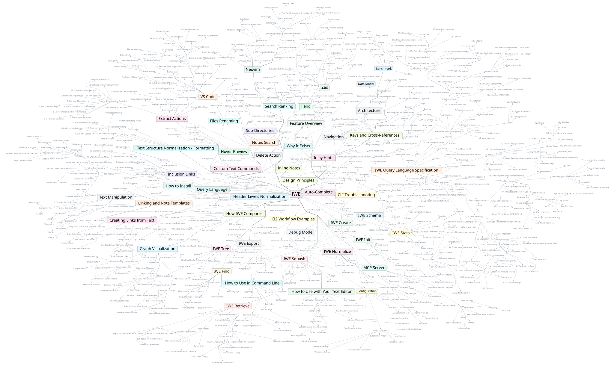

# IWE：あなたと AI エージェントのための Markdown ナレッジグラフ

IWE は、Markdown ファイルのフォルダをナレッジグラフに変えます。あなたはエディタから LSP サーバー経由でグラフを閲覧・リファクタリングし、AI エージェントは CLI と MCP サーバー経由でグラフを検索します。同じファイル、同じリンクです。Rust で書かれており、データベースもクラウドもアカウントも必要ありません。

ノートに対してデータベースのようなクエリを使いたい人のためのツールです。「このサブツリー以下のすべての下書き」「第 1 四半期に採用されたすべての決定」といったクエリを、ノートを実際のデータベースに移すことなく実行できます。

[](https://github.com/iwe-org/iwe/stargazers)
[](https://crates.io/crates/iwe)
[](https://crates.io/crates/iwe)
[](https://github.com/iwe-org/iwe/blob/master/LICENSE-APACHE)

[クイックスタート](#クイックスタート) · [仕組み](#仕組み) · [エディタ](#エディタで使う) · [CLI](#cli) · [AI エージェント](#ai-エージェント) · [Mac アプリ](#iwe-for-mac) · [テンプレート](#ワークスペーステンプレート) · [比較](docs/comparison.md) · [iwe.md](https://iwe.md/?ref=readme-header)

[English](README.md) · [简体中文](README.zh-CN.md) · [한국어](README.ko.md) · **日本語** · [Deutsch](README.de.md)

`````console
$ iwe find --lexical "rename" --limit 2
- [IWE Rename](cli-rename) -> [Inclusion Links](inclusion-links) <- [How to Use in Command Line](cli), [Files Renaming](feature-renaming)
- [Files Renaming](feature-renaming) -> [IWE Rename](cli-rename) <- [IWE](index)

$ iwe tree -k index
- [IWE](index)
  - [Architecture](architecture)
    - [Benchmark](benchmark)
    - [Data Model](data-model)
    - [Keys and Cross-References](keys)
  - [How to Use in Command Line](cli)
  ...

$ iwe retrieve -k feature-renaming
````markdown #feature-renaming
---
title: Files Renaming
includedBy:
- key: index
  title: IWE
  sectionPath:
  - Features
---

# Files Renaming
...
`````

このリポジトリ自身の [`docs/`](docs/) フォルダで実行した出力で、`...` の箇所は省略しています。検索結果には、そのノートがリンクしている先（`->`）と、そのノートにリンクしている元（`<-`）が付きます。取得したノートには、グラフ内での位置が付きます。

## クイックスタート

```bash
brew install iwe-org/iwe/iwe
```

npm（`npm install -g @iwe-org/iwe`）と Cargo（`cargo install iwe iwes iwec`）でもインストールできます。[インストールガイド](https://iwe.md/docs/getting-started/installation/)をご覧ください。

次に、すでに Markdown ファイルがあるフォルダで：

```bash
iwe init
iwe find
iwe tree
```

ここから、[エディタ](#エディタで使う)を設定するか、[エージェント](#ai-エージェント)を接続してください。両方でもかまいません。

IWE が役に立ったら、star を付けてもらえると、他の人が見つけやすくなります。

## 仕組み

IWE は、ノートを 2 種類のリンクで作られたつながりのある構造として扱います：

- **ネスト。** 単独の行に置かれたリンクは「このトピックはあのサブトピックを含む」という意味です。ノートは閲覧・リファクタリングできるツリーになります。IWE はこれを[インクルージョンリンク](https://iwe.md/docs/concepts/inclusion-links/)と呼びます。
- **相互参照。** 通常のインラインリンクが、異なるトピックのノートをつなぎます。
- **複数の親。** 同じノートを複数の場所に同時に置けます。「瞑想」のノートは、ファイルを複製せずに「健康」と「生産性」の両方に属せます。
- **親からのコンテキスト。** ノートを取得するとき、IWE は階層で上にあるノートのコンテキストを含めることができます。

[](docs/feature-visualization.md)

*IWE 自身のドキュメント：インデックス以下の 52 のドキュメントとその 720 のセクションを `iwe export` で書き出し、Graphviz で配置したものです。[自分のノートで描く](docs/feature-visualization.md)。*

得られるもの：

- **普通の Markdown、完全な所有権。** ノートはローカルディレクトリの `.md` ファイルです。読んで、編集して、`git push` できます。
- **類似度の推測ではなく、構造による検索。** あいまい検索と全文検索が入口を見つけ、グラフがその結果を使えるコンテキストに変えます：親、子、相互参照。
- **リンクを壊さないリファクタリング。** リネーム、抽出、インライン化、削除は、すべての参照を更新します。
- **検証される書き込み。** frontmatter とドキュメント構造は、種類ごとの[ドキュメントスキーマ](https://iwe.md/docs/concepts/document-schema/)に照らして検証されます。編集は、触れてよいドキュメント数とブロック数を宣言でき、合わなければ何も書き込む前に中止されます。
- **高速。** ノート PC で、20,000 件のノートのグラフを 1 秒未満で構築します（[ベンチマーク](docs/benchmark.md)）。
- **AI は内蔵していません。** IWE はそれ自体でノートのためのツールとして動作します。AI の助けが必要なときは、すでに使っているエージェントと組み合わせて使えます。

marksman、markdown-oxide、Obsidian、zk との違いと、IWE が劣る点について：[IWE の比較](docs/comparison.md)。

## エディタで使う

IWE は、エディタに Markdown ノート向けの IDE のような機能を加えます。[Neovim](https://iwe.md/docs/editors/neovim/)、[Helix](https://iwe.md/docs/editors/helix/)、[VS Code](https://iwe.md/docs/editors/vscode/)、[Zed](https://iwe.md/docs/editors/zed/)、そして Language Server Protocol に対応するあらゆるエディタで動作します。

- **ナビゲーション。** 定義へ移動、参照の検索（バックリンク）、タイトルや内容でのノート検索。
- **リネーム。** ファイル名を変えると、そのファイルへのすべてのリンクが更新されます。
- **抽出とインライン化。** セクションを新しいノートに切り出したり、ノートを親ノートに埋め戻したりできます。
- **自動補完とホバー。** 入力中にリンクを提案し、ホバーでプレビューを表示します。
- **インレイヒント。** 親への参照とリンク数をその場に表示します。
- **フォーマット。** ドキュメントの正規化、リンクタイトルの更新、見出しとリストの相互変換。

エディタプラグイン： [iwe.nvim](https://github.com/iwe-org/iwe.nvim) · [vscode-iwe](https://github.com/iwe-org/vscode-iwe) · [zed-iwe](https://github.com/iwe-org/zed-iwe)

## CLI

| コマンド | 内容 |
|---|---|
| `find` | あいまい検索と全文検索のランキング、frontmatter とグラフのエッジに対するフィルタ |
| `retrieve` | 1 回の呼び出しで、ドキュメントとリンクされたコンテキストを取得 |
| `tree` | 任意の起点から階層を表示 |
| `update` | ガード付きの編集：frontmatter の変更とブロック単位の操作 |
| `schema` | ストアのスキーマを推論、またはそれに照らしてドキュメントを検証 |

すべてのコマンド（`new`、`extract`、`inline`、`rename`、`delete`、`squash`、`stats`、`normalize`、`export` など）は [CLI リファレンス](https://iwe.md/docs/cli/)にあり、このリポジトリには[ワークフローの例](docs/cli-workflows.md)もあります。

## AI エージェント

同じノートを Claude Code、Claude Desktop、Codex、Gemini、Cursor、そして [Model Context Protocol](https://modelcontextprotocol.io) に対応するあらゆるツールで使えます。

**Claude Code** — プラグインをインストールしてから、記憶させたいプロジェクトで `/iwe:init` を実行します：

```text
/plugin marketplace add iwe-org/skills
/plugin install iwe@iwe-org
/iwe:init
```

**あらゆる MCP エージェント** — MCP サーバーを指定します。`iwec` は実行されたディレクトリを対象にするので、作業ディレクトリをノートのフォルダに設定してください：

```json
{
  "mcpServers": {
    "iwe": {
      "command": "iwec",
      "cwd": "~/notes"
    }
  }
}
```

何もインストールしなくても、`npx` が必要に応じてサーバーを取得します：`"command": "npx"` と `"args": ["-y", "@iwe-org/mcp"]` を使ってください。詳しくは[エージェント接続ガイド](https://iwe.md/docs/agentic/)をご覧ください。

あるいは、エージェント自身にセットアップさせることもできます。コマンドを実行できるエージェントに、次の内容を貼り付けてください：

```text
私のノート用に IWE をセットアップして：インストールし（brew install iwe-org/iwe/iwe、
npm install -g @iwe-org/iwe、または cargo install iwe iwes iwec）、ノートの
ディレクトリで `iwe init` を実行してから、作業ディレクトリをそのフォルダに設定して
`iwec` MCP サーバーを追加して。
ドキュメント：https://iwe.md/docs/agentic/
```

## iWe for Mac

iWe は、同じ Markdown フォルダのための無料のネイティブ Mac アプリです。ネイティブの SwiftUI エディタで、Electron は使わず、CLI と同じ Rust エンジンの上に作られています。ノートのフォルダを開くと、キーボード中心の執筆・閲覧スペースが手に入り、既存の Claude Code や Codex エージェントが目の前でドキュメントを編集します。エディタや他のツールも同じファイルで作業を続けられます。

**[iwe.md から DMG をダウンロード →](https://iwe.md/app/?ref=readme-download)** · 無料 · macOS 15 以降 · アカウント不要

<a href="https://iwe.md/app/?ref=readme-shot"></a>

- **すでに使っているエージェントと一緒に。** ノートについて質問したり、エージェントに下書きや再構成を任せたりできます。作業中、編集内容がドキュメントに現れます。
- **エージェントの実行 1 回が、取り消し 1 ステップ。** アイデアを試して、気に入らなければ元に戻してください。
- **キーボード優先。** オプションの Vim キー、数回のキー操作での検索、関連ノート間の移動、ドキュメント内に描画される Mermaid 図。

**ページの中で書くエージェント**（2 分）— Claude Code が段落を引き締め、新しいセクションを書き、未解決バグのチャートを追加します。バグのステージが変わるたびにチャートが描き直されます。

https://github.com/user-attachments/assets/e57763df-46c9-4aea-92a2-ddd0d1010091

**ノートのための Vim キー**（2 分）— ブロック単位で移動し、リンクをたどり、検索し、箇条書きを切り取って貼り付け、取り消しとやり直しまで、すべてキーボードから手を離さずに行います。

https://github.com/user-attachments/assets/c3edd2cb-4b7c-4f68-9eda-58aa740c1b23

**[そのほかのスクリーンショットと、字幕付きの 2 本の動画は iwe.md で →](https://iwe.md/app/?ref=readme-video#videos)**

## ワークスペーステンプレート

テンプレートは、ワークスペース全体の出発点となるコンテンツです。ドキュメント、スキーマ、ワークスペース設定、そしてエージェントが使う指示とスキルが含まれます。どれも普通の Markdown リポジトリなので、使う前に読めます。

- [Dev Workspace](https://github.com/iwe-org/dev-workspace) — コーディングエージェントが管理するソフトウェアプロジェクトのナレッジベース：プロダクト、仕様、計画、バグ、リリース、学びをひとつのグラフにまとめます。
- [Marketing Workspace](https://github.com/iwe-org/marketing-workspace) — マーケティングエージェントのためのキャンペーンメモリ：67 のローンチ先、CRM、投稿、返信、リード。
- [Seventeen Centuries](https://github.com/iwe-org/seventeen-centuries-workspace) — マルクス・アウレリウス、マキャヴェッリ、ニーチェをひとつのグラフに：843 の節と 331 の概念、そのうち 42 は 3 冊すべてを通してたどれます。

使うには、テンプレートのリポジトリをクローンして CLI やエディタでそのフォルダで作業するか、iWe for Mac で File ▸ New Workspace from Template… を選びます。そのほかのテンプレートと、自分のテンプレートを提出する方法は[テンプレートレジストリ](https://github.com/iwe-org/templates)にあります。

## 参加する

すでに複数のプロジェクトが、エージェントのメモリバックエンドや他のツールのグラフ層として IWE の上に作られています。[更新され続けているリスト](https://github.com/iwe-org/iwe/discussions/362)をご覧のうえ、あなたのプロジェクトも追加してください。壊してはいけないものが分かります。現在サポートされている連携方法は CLI と MCP サーバーです。

質問、粗い部分の指摘、使い方の例は、すべて [Discussions](https://github.com/iwe-org/iwe/discussions) で歓迎します。[バグ](https://github.com/iwe-org/iwe/issues)の報告や、[ドキュメント](docs/)の改善への協力も歓迎します。

**コミュニティ：** [Twitter/X](https://x.com/iwe_md) · [Reddit](https://www.reddit.com/r/iwe/) · [Discussions](https://github.com/iwe-org/iwe/discussions)

## ライセンス

[Apache License 2.0](LICENSE-APACHE)
