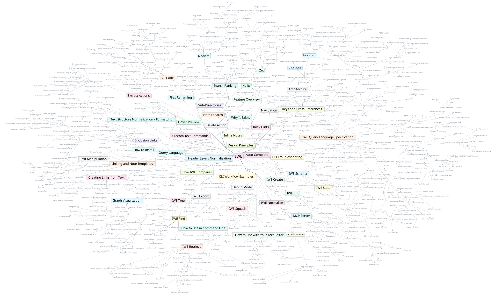

# IWE: 당신과 AI 에이전트를 위한 Markdown 지식 그래프

IWE는 Markdown 파일 폴더를 지식 그래프로 바꿉니다. 당신은 편집기에서 LSP 서버를 통해 그래프를 탐색하고 리팩터링하며, AI 에이전트는 CLI와 MCP 서버를 통해 그래프를 조회합니다. 같은 파일, 같은 링크입니다. Rust로 작성되었고 데이터베이스도 클라우드도 계정도 필요 없습니다.

노트에 데이터베이스 같은 질의를 하고 싶은 사람을 위한 도구입니다. "이 하위 트리 아래의 모든 초안", "1분기에 채택된 모든 결정" 같은 질의를, 노트를 실제 데이터베이스로 옮기지 않고도 할 수 있습니다.

[](https://github.com/iwe-org/iwe/stargazers)
[](https://crates.io/crates/iwe)
[](https://crates.io/crates/iwe)
[](https://github.com/iwe-org/iwe/blob/master/LICENSE-APACHE)

[빠른 시작](#빠른-시작) · [작동 방식](#작동-방식) · [편집기](#편집기에서) · [CLI](#cli) · [AI 에이전트](#ai-에이전트) · [Mac 앱](#iwe-for-mac) · [템플릿](#워크스페이스-템플릿) · [비교](docs/comparison.md) · [iwe.md](https://iwe.md/?ref=readme-header)

[English](README.md) · [简体中文](README.zh-CN.md) · **한국어** · [日本語](README.ja.md) · [Deutsch](README.de.md)

`````console
$ iwe find --lexical "rename" --limit 2
- [IWE Rename](cli-rename) -> [Inclusion Links](inclusion-links) <- [How to Use in Command Line](cli), [Files Renaming](feature-renaming)
- [Files Renaming](feature-renaming) -> [IWE Rename](cli-rename) <- [IWE](index)

$ iwe tree -k index
- [IWE](index)
  - [Architecture](architecture)
    - [Benchmark](benchmark)
    - [Data Model](data-model)
    - [Keys and Cross-References](keys)
  - [How to Use in Command Line](cli)
  ...

$ iwe retrieve -k feature-renaming
````markdown #feature-renaming
---
title: Files Renaming
includedBy:
- key: index
  title: IWE
  sectionPath:
  - Features
---

# Files Renaming
...
`````

이 저장소의 [`docs/`](docs/) 폴더에서 실행한 출력이며, `...`로 표시한 곳은 줄였습니다. 검색 결과에는 그 노트가 링크하는 노트(`->`)와 그 노트를 링크하는 노트(`<-`)가 함께 나오고, 가져온 노트에는 그래프에서의 위치가 함께 나옵니다.

## 빠른 시작

```bash
brew install iwe-org/iwe/iwe
```

npm(`npm install -g @iwe-org/iwe`)과 Cargo(`cargo install iwe iwes iwec`)로도 설치할 수 있습니다. [설치 가이드](https://iwe.md/docs/getting-started/installation/)를 참고하세요.

그런 다음, 이미 Markdown 파일이 있는 폴더에서:

```bash
iwe init
iwe find
iwe tree
```

이제 [편집기](#편집기에서)를 설정하거나 [에이전트](#ai-에이전트)를 연결하세요. 둘 다 해도 됩니다.

IWE가 유용하다면 star를 눌러 주세요. 다른 사람들이 찾는 데 도움이 됩니다.

## 작동 방식

IWE는 노트를 두 종류의 링크로 이루어진 연결 구조로 다룹니다:

- **중첩.** 한 줄을 차지하는 링크는 "이 주제가 저 하위 주제를 포함한다"는 뜻입니다. 노트는 탐색하고 리팩터링할 수 있는 트리를 이룹니다. IWE는 이를 [포함 링크](https://iwe.md/docs/concepts/inclusion-links/)라고 부릅니다.
- **교차 참조.** 일반 인라인 링크가 서로 다른 주제의 노트를 연결합니다.
- **여러 부모.** 같은 노트가 여러 위치에 동시에 속할 수 있습니다. "명상" 노트는 파일을 복제하지 않고도 "건강"과 "생산성" 모두에 속할 수 있습니다.
- **부모로부터의 맥락.** 노트를 가져올 때 IWE는 계층에서 그 위에 있는 노트의 맥락을 함께 포함할 수 있습니다.

[](docs/feature-visualization.md)

*IWE 자체 문서: 인덱스 아래의 문서 52개와 그 섹션 720개를 `iwe export`로 내보내고 Graphviz로 배치했습니다. [내 노트로 그리기](docs/feature-visualization.md).*

얻을 수 있는 것:

- **평범한 Markdown, 완전한 소유권.** 노트는 로컬 디렉터리의 `.md` 파일입니다. 읽고, 편집하고, `git push` 하세요.
- **유사도 추측이 아닌 구조에 의한 검색.** 퍼지 검색과 전문 검색이 진입점을 찾고, 그래프가 그 결과를 쓸 수 있는 맥락으로 바꿉니다: 부모, 자식, 교차 참조.
- **링크를 깨뜨리지 않는 리팩터링.** 이름 변경, 추출, 인라인, 삭제가 모든 참조를 갱신합니다.
- **검증되는 쓰기.** frontmatter와 문서 구조는 유형별 [문서 스키마](https://iwe.md/docs/concepts/document-schema/)에 따라 검증됩니다. 편집은 건드릴 수 있는 문서와 블록의 수를 선언할 수 있고, 맞지 않으면 아무것도 쓰기 전에 중단됩니다.
- **빠릅니다.** 노트북에서 노트 20,000개의 그래프를 1초 안에 만듭니다([벤치마크](docs/benchmark.md)).
- **AI는 내장되어 있지 않습니다.** IWE는 그 자체로 노트를 위한 도구로 작동합니다. AI의 도움이 필요할 때는 이미 쓰고 있는 에이전트와 함께 작동합니다.

marksman, markdown-oxide, Obsidian, zk와 어떻게 다른지, 그리고 IWE가 약한 부분은 어디인지: [IWE 비교](docs/comparison.md).

## 편집기에서

IWE는 편집기에 Markdown 노트를 위한 IDE 같은 기능을 더합니다. [Neovim](https://iwe.md/docs/editors/neovim/), [Helix](https://iwe.md/docs/editors/helix/), [VS Code](https://iwe.md/docs/editors/vscode/), [Zed](https://iwe.md/docs/editors/zed/), 그리고 Language Server Protocol을 지원하는 모든 편집기에서 작동합니다.

- **탐색.** 정의로 이동, 참조 찾기(백링크), 제목이나 내용으로 노트 검색.
- **이름 변경.** 파일 이름을 바꾸면 그 파일을 가리키는 모든 링크가 갱신됩니다.
- **추출과 인라인.** 섹션을 새 노트로 빼내거나, 노트를 부모 노트 안으로 다시 넣습니다.
- **자동 완성과 호버.** 입력하는 동안 링크를 제안하고, 호버하면 미리 보기를 보여 줍니다.
- **인레이 힌트.** 부모 참조와 링크 수를 그 자리에 표시합니다.
- **포맷.** 문서 정규화, 링크 제목 갱신, 헤더와 목록 사이의 변환.

편집기 플러그인: [iwe.nvim](https://github.com/iwe-org/iwe.nvim) · [vscode-iwe](https://github.com/iwe-org/vscode-iwe) · [zed-iwe](https://github.com/iwe-org/zed-iwe)

## CLI

| 명령 | 하는 일 |
|---|---|
| `find` | 퍼지 및 전문 순위 검색, frontmatter와 그래프 간선에 대한 필터 |
| `retrieve` | 한 번의 호출로 문서와 연결된 맥락을 가져오기 |
| `tree` | 임의의 시작점에서 계층 구조 보기 |
| `update` | 보호되는 편집: frontmatter 변경과 블록 단위 작업 |
| `schema` | 저장소의 스키마를 추론하거나, 그에 따라 문서를 검증 |

전체 명령 — `new`, `extract`, `inline`, `rename`, `delete`, `squash`, `stats`, `normalize`, `export` 등 — 은 [CLI 레퍼런스](https://iwe.md/docs/cli/)에 있고, 이 저장소에는 [워크플로 예제](docs/cli-workflows.md)도 있습니다.

## AI 에이전트

같은 노트를 Claude Code, Claude Desktop, Codex, Gemini, Cursor, 그리고 [Model Context Protocol](https://modelcontextprotocol.io)을 지원하는 모든 도구에서 사용할 수 있습니다.

**Claude Code** — 플러그인을 설치한 뒤, 기억하게 하고 싶은 프로젝트에서 `/iwe:init`을 실행하세요:

```text
/plugin marketplace add iwe-org/skills
/plugin install iwe@iwe-org
/iwe:init
```

**모든 MCP 에이전트** — MCP 서버를 가리키게 하세요. `iwec`는 실행된 디렉터리를 서비스하므로, 작업 디렉터리를 노트 폴더로 지정합니다:

```json
{
  "mcpServers": {
    "iwe": {
      "command": "iwec",
      "cwd": "~/notes"
    }
  }
}
```

아무것도 설치하지 않아도 `npx`가 필요할 때 서버를 가져옵니다: `"command": "npx"`와 `"args": ["-y", "@iwe-org/mcp"]`를 사용하세요. 자세한 내용은 [에이전트 연결 가이드](https://iwe.md/docs/agentic/)에 있습니다.

또는 에이전트가 직접 설정하게 할 수도 있습니다. 명령을 실행할 수 있는 에이전트에게 다음을 붙여 넣으세요:

```text
내 노트를 위해 IWE를 설정해 줘: 설치하고(brew install iwe-org/iwe/iwe,
npm install -g @iwe-org/iwe, 또는 cargo install iwe iwes iwec), 내 노트
디렉터리에서 `iwe init`을 실행한 다음, 작업 디렉터리를 그 폴더로 지정해
`iwec` MCP 서버를 추가해 줘.
문서: https://iwe.md/docs/agentic/
```

## iWe for Mac

iWe는 같은 Markdown 폴더를 위한 무료 네이티브 Mac 앱입니다. 네이티브 SwiftUI 편집기이며 Electron을 쓰지 않고, CLI와 같은 Rust 엔진 위에 만들어졌습니다. 노트 폴더를 열면 키보드 중심의 작성·탐색 공간이 생기고, 기존 Claude Code나 Codex 에이전트가 눈앞에서 문서를 편집합니다. 편집기와 다른 도구들도 같은 파일로 계속 작업할 수 있습니다.

**[iwe.md에서 DMG 다운로드 →](https://iwe.md/app/?ref=readme-download)** · 무료 · macOS 15 이상 · 계정 불필요

<a href="https://iwe.md/app/?ref=readme-shot"></a>

- **이미 쓰고 있는 에이전트와 함께.** 노트에 대해 질문하거나, 에이전트에게 초안 작성과 재구성을 맡기세요. 작업하는 동안 수정 사항이 문서에 나타납니다.
- **에이전트 실행 한 번이 실행 취소 한 단계.** 아이디어를 시도해 보고, 마음에 들지 않으면 되돌리세요.
- **키보드 우선.** 선택 사항인 Vim 키, 몇 번의 키 입력으로 하는 검색, 관련 노트 사이의 이동, 문서 안에서 렌더링되는 Mermaid 다이어그램.

**페이지 안에서 글을 쓰는 에이전트** (2분) — Claude Code가 문단을 다듬고, 새 섹션을 쓰고, 미해결 버그 차트를 추가합니다. 버그의 단계가 바뀔 때마다 차트가 다시 그려집니다.

https://github.com/user-attachments/assets/e57763df-46c9-4aea-92a2-ddd0d1010091

**노트를 위한 Vim 키** (2분) — 블록 단위로 이동하고, 링크를 따라가고, 검색하고, 목록 항목을 잘라 붙이고, 실행 취소와 다시 실행까지 모두 키보드에서 손을 떼지 않고 합니다.

https://github.com/user-attachments/assets/c3edd2cb-4b7c-4f68-9eda-58aa740c1b23

**[더 많은 스크린샷과 자막이 있는 두 영상은 iwe.md에서 →](https://iwe.md/app/?ref=readme-video#videos)**

## 워크스페이스 템플릿

템플릿은 워크스페이스 전체의 시작 콘텐츠입니다. 문서, 스키마, 워크스페이스 설정, 그리고 에이전트가 실행할 때 쓰는 지침과 스킬이 들어 있습니다. 각 템플릿은 평범한 Markdown 저장소이므로 사용하기 전에 읽어 볼 수 있습니다.

- [Dev Workspace](https://github.com/iwe-org/dev-workspace) — 코딩 에이전트가 관리하는 소프트웨어 프로젝트 지식 베이스: 제품, 스펙, 계획, 버그, 릴리스, 배운 점을 하나의 그래프로 담습니다.
- [Marketing Workspace](https://github.com/iwe-org/marketing-workspace) — 마케팅 에이전트를 위한 캠페인 메모리: 67개의 출시 채널, CRM, 게시물, 답글, 리드.
- [Seventeen Centuries](https://github.com/iwe-org/seventeen-centuries-workspace) — 마르쿠스 아우렐리우스, 마키아벨리, 니체를 하나의 그래프로: 843개의 구절과 331개의 개념, 그중 42개는 세 권 모두에 걸쳐 추적됩니다.

사용하려면 템플릿 저장소를 클론해 CLI나 편집기로 그 폴더에서 작업하거나, iWe for Mac에서 File ▸ New Workspace from Template…을 선택하세요. 더 많은 템플릿과 직접 제출하는 방법은 [템플릿 레지스트리](https://github.com/iwe-org/templates)에 있습니다.

## 참여하기

이미 여러 프로젝트가 IWE를 에이전트 메모리 백엔드나 다른 도구의 그래프 계층으로 사용하고 있습니다. [계속 갱신되는 목록](https://github.com/iwe-org/iwe/discussions/362)을 보고, 당신의 프로젝트도 추가해 주세요. 무엇을 깨뜨리지 말아야 할지 알 수 있습니다. 현재 지원되는 통합 방식은 CLI와 MCP 서버입니다.

질문, 아쉬운 점, 사용 사례 모두 [Discussions](https://github.com/iwe-org/iwe/discussions)에서 환영합니다. [버그](https://github.com/iwe-org/iwe/issues)를 제보하거나 [문서](docs/) 개선을 도와주실 수도 있습니다.

**커뮤니티:** [Twitter/X](https://x.com/iwe_md) · [Reddit](https://www.reddit.com/r/iwe/) · [Discussions](https://github.com/iwe-org/iwe/discussions)

## 라이선스

[Apache License 2.0](LICENSE-APACHE)
