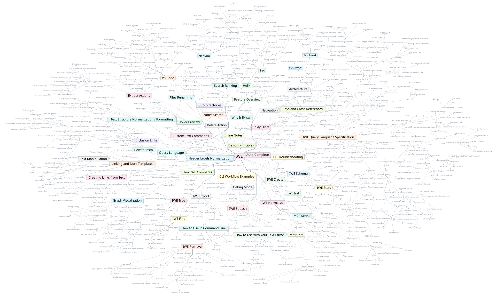

# IWE: a Markdown knowledge graph for you and your AI agents

IWE turns a folder of Markdown files into a knowledge graph. You browse and refactor it from your editor through an LSP server, and your AI agent queries it through a CLI and an MCP server. Same files, same links. It is written in Rust and needs no database, no cloud and no account.

It is for people who want database-style queries on their notes — "all drafts under this subtree", "every accepted decision in Q1" — without moving them into an actual database.

[](https://github.com/iwe-org/iwe/stargazers)
[](https://crates.io/crates/iwe)
[](https://crates.io/crates/iwe)
[](https://github.com/iwe-org/iwe/blob/master/LICENSE-APACHE)

[Quick start](#quick-start) · [How it works](#how-it-works) · [Editor](#in-your-editor) · [CLI](#cli) · [AI agents](#ai-agents) · [Mac app](#iwe-for-mac) · [Templates](#workspace-templates) · [Comparison](docs/comparison.md) · [iwe.md](https://iwe.md/?ref=readme-header)

**English** · [简体中文](README.zh-CN.md) · [한국어](README.ko.md) · [日本語](README.ja.md) · [Deutsch](README.de.md)

`````console
$ iwe find --lexical "rename" --limit 2
- [IWE Rename](cli-rename) -> [Inclusion Links](inclusion-links) <- [How to Use in Command Line](cli), [Files Renaming](feature-renaming)
- [Files Renaming](feature-renaming) -> [IWE Rename](cli-rename) <- [IWE](index)

$ iwe tree -k index
- [IWE](index)
  - [Architecture](architecture)
    - [Benchmark](benchmark)
    - [Data Model](data-model)
    - [Keys and Cross-References](keys)
  - [How to Use in Command Line](cli)
  ...

$ iwe retrieve -k feature-renaming
````markdown #feature-renaming
---
title: Files Renaming
includedBy:
- key: index
  title: IWE
  sectionPath:
  - Features
---

# Files Renaming
...
`````

Output from this repository's own [`docs/`](docs/) folder, shortened where marked `...`. A search hit comes back with what it links to (`->`) and what links to it (`<-`); a retrieved note comes back with where it sits in the graph.

## Quick start

```bash
brew install iwe-org/iwe/iwe
```

Also on npm (`npm install -g @iwe-org/iwe`) and Cargo (`cargo install iwe iwes iwec`); see the [installation guide](https://iwe.md/docs/getting-started/installation/).

Then, in a folder that already has Markdown files:

```bash
iwe init
iwe find
iwe tree
```

From here, set up [your editor](#in-your-editor), connect [your agent](#ai-agents), or both.

If IWE is useful to you, a star helps other people find it.

## How it works

IWE treats your notes as a connected structure built from two kinds of links:

- **Nesting.** A link on its own line means "this topic includes that subtopic". Your notes form a tree you can browse and refactor. IWE calls these [inclusion links](https://iwe.md/docs/concepts/inclusion-links/).
- **Cross-references.** Regular inline links connect notes across topics.
- **Multiple parents.** The same note can live under several places at once. A "Meditation" note can belong to both "Health" and "Productivity" without duplicating the file.
- **Context from parents.** When you retrieve a note, IWE can include context from the notes above it in the hierarchy.

[](docs/feature-visualization.md)

*IWE's own documentation: the 52 documents under its index and their 720 sections, exported with `iwe export` and laid out by Graphviz. [Draw your own](docs/feature-visualization.md).*

What you get:

- **Plain Markdown, full ownership.** Your notes are `.md` files in a local directory. Read them, edit them, `git push` them.
- **Retrieval by structure, not similarity guessing.** Fuzzy and full-text search find the entry point; the graph turns a hit into usable context: parents, children, cross-references.
- **Refactoring that keeps links intact.** Rename, extract, inline and delete update every reference.
- **Checked writes.** Frontmatter and document structure are validated against per-type [document schemas](https://iwe.md/docs/concepts/document-schema/), and an edit can declare how many documents and blocks it may touch, so a mismatch aborts before anything is written.
- **Fast.** The graph for 20,000 notes builds in under a second on a laptop ([benchmark](docs/benchmark.md)).
- **No built-in AI.** IWE works on its own as a tool for your notes. When you want AI help, it works alongside the agent you already use.

How it differs from marksman, markdown-oxide, Obsidian and zk, including where IWE is weaker: [How IWE compares](docs/comparison.md).

## In your editor

IWE gives your editor IDE-like features for Markdown notes. It works with [Neovim](https://iwe.md/docs/editors/neovim/), [Helix](https://iwe.md/docs/editors/helix/), [VS Code](https://iwe.md/docs/editors/vscode/), [Zed](https://iwe.md/docs/editors/zed/), and any editor that supports the Language Server Protocol.

- **Navigate.** Go to definition, find references (backlinks), search notes by title or content.
- **Rename.** Rename a file and every link to it is updated.
- **Extract and inline.** Pull a section into a new note, or embed a note back into its parent.
- **Auto-complete and hover.** Link suggestions as you type, previews on hover.
- **Inlay hints.** Parent references and link counts shown in place.
- **Format.** Normalize documents, update link titles, convert between headers and lists.

Editor plugins: [iwe.nvim](https://github.com/iwe-org/iwe.nvim) · [vscode-iwe](https://github.com/iwe-org/vscode-iwe) · [zed-iwe](https://github.com/iwe-org/zed-iwe)

## CLI

| Command | What it does |
|---|---|
| `find` | Search with fuzzy and full-text ranking, plus filters over frontmatter and graph edges |
| `retrieve` | Get a document with its linked context in one call |
| `tree` | Show the hierarchy from any starting point |
| `update` | Guarded edits: frontmatter changes and targeted block operations |
| `schema` | Infer the store's schemas, or validate documents against them |

The full set — `new`, `extract`, `inline`, `rename`, `delete`, `squash`, `stats`, `normalize`, `export` and more — is in the [CLI reference](https://iwe.md/docs/cli/), with [workflow examples](docs/cli-workflows.md) in this repository.

## AI agents

The same notes work with Claude Code, Claude Desktop, Codex, Gemini, Cursor, and any tool that supports the [Model Context Protocol](https://modelcontextprotocol.io).

**Claude Code** — install the plugin, then run `/iwe:init` in any project you want remembered:

```text
/plugin marketplace add iwe-org/skills
/plugin install iwe@iwe-org
/iwe:init
```

**Any MCP agent** — point it at the MCP server. `iwec` serves the directory it runs in, so set the working directory to your notes:

```json
{
  "mcpServers": {
    "iwe": {
      "command": "iwec",
      "cwd": "~/notes"
    }
  }
}
```

Without installing anything, `npx` fetches the server on demand: use `"command": "npx"` with `"args": ["-y", "@iwe-org/mcp"]`. More in the [agent connection guide](https://iwe.md/docs/agentic/).

Or let the agent set itself up — paste this into any agent that can run commands:

```text
Set up IWE for my notes: install it (brew install iwe-org/iwe/iwe,
npm install -g @iwe-org/iwe, or cargo install iwe iwes iwec), run `iwe init`
in my notes directory, then add the `iwec` MCP server with its working
directory set to that folder.
Docs: https://iwe.md/docs/agentic/
```

## iWe for Mac

iWe is a free native Mac app for the same folder of Markdown: a native SwiftUI editor, no Electron, built on the same Rust engine as the CLI. Open a folder of notes and you get a keyboard-driven space to write and browse, with your existing Claude Code or Codex agent editing the document in front of you. Your editor and other tools keep working on the same files.

**[Download the DMG from iwe.md →](https://iwe.md/app/?ref=readme-download)** · free · macOS 15 or later · no account

<a href="https://iwe.md/app/?ref=readme-shot"></a>

- **Works with the agent you already have.** Ask about your notes, or have the agent draft and reorganize them. Its edits appear in the document as it works.
- **One undo step per agent run.** Try an idea, and roll it back if you don't like it.
- **Keyboard first.** Optional Vim keys, search in a few keystrokes, jumps between related notes, Mermaid diagrams rendered in the document.

**Your agent, writing in the page** (2 min) — Claude Code tightens a paragraph, writes a new section, then adds a chart of the open bugs that redraws as each bug changes stage.

https://github.com/user-attachments/assets/e57763df-46c9-4aea-92a2-ddd0d1010091

**Vim keys for your notes** (2 min) — Move block by block, follow links, search, cut and paste bullets, undo and redo, all without leaving the keyboard.

https://github.com/user-attachments/assets/c3edd2cb-4b7c-4f68-9eda-58aa740c1b23

**[More screenshots, and both videos with captions, on iwe.md →](https://iwe.md/app/?ref=readme-video#videos)**

## Workspace templates

A template is the starting content of a whole workspace: documents, schemas, the workspace config, and the instructions and skills your agent runs with. Each one is an ordinary repository of Markdown you can read before you use it.

- [Dev Workspace](https://github.com/iwe-org/dev-workspace) — a knowledge base for a software project, kept by your coding agent: product, specs, plans, bugs, releases and learnings as a graph.
- [Marketing Workspace](https://github.com/iwe-org/marketing-workspace) — campaign memory for a marketing agent: 67 launch venues, a CRM, posts, replies and leads.
- [Seventeen Centuries](https://github.com/iwe-org/seventeen-centuries-workspace) — Marcus Aurelius, Machiavelli and Nietzsche as one graph: 843 passages and 331 concepts, 42 of them traced through all three books.

To use one, clone its repository and work in that folder with the CLI or your editor, or pick it in iWe for Mac under File ▸ New Workspace from Template…. More templates, and how to submit your own, are in the [template registry](https://github.com/iwe-org/templates).

## Get involved

Projects already build on IWE, as an agent-memory backend and as the graph layer of other tools: see the [running list](https://github.com/iwe-org/iwe/discussions/362), and add yours so we know what not to break. The CLI and the MCP server are the supported ways to integrate today.

Questions, rough edges and examples of how you use it are welcome in [Discussions](https://github.com/iwe-org/iwe/discussions). You can also report a [bug](https://github.com/iwe-org/iwe/issues) or help improve the [documentation](docs/).

**Community:** [Twitter/X](https://x.com/iwe_md) · [Reddit](https://www.reddit.com/r/iwe/) · [Discussions](https://github.com/iwe-org/iwe/discussions)

## License

[Apache License 2.0](LICENSE-APACHE)
