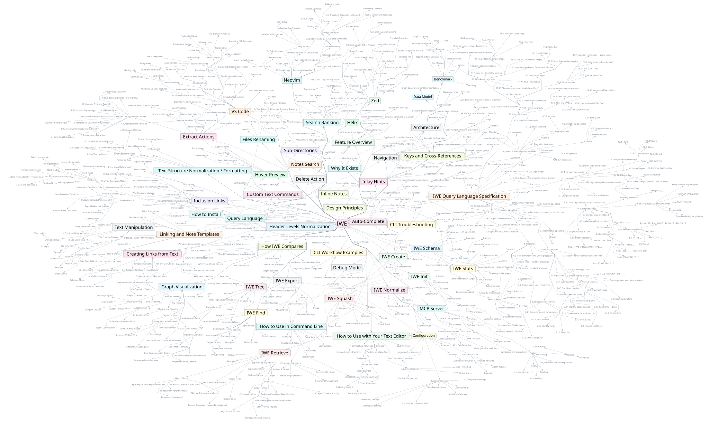

# IWE：为你和 AI 智能体准备的 Markdown 知识图谱

IWE 把一个 Markdown 文件夹变成知识图谱。你在编辑器里通过 LSP 服务器浏览和重构它，你的 AI 智能体通过 CLI 和 MCP 服务器查询它。同一批文件，同一批链接。它用 Rust 编写，不需要数据库、云服务或账号。

它适合想对自己的笔记做数据库式查询的人——“这棵子树下的所有草稿”“第一季度所有已采纳的决策”——而不必把笔记搬进真正的数据库。

[](https://github.com/iwe-org/iwe/stargazers)
[](https://crates.io/crates/iwe)
[](https://crates.io/crates/iwe)
[](https://github.com/iwe-org/iwe/blob/master/LICENSE-APACHE)

[快速开始](#快速开始) · [工作原理](#工作原理) · [编辑器](#在你的编辑器中) · [CLI](#cli) · [AI 智能体](#ai-智能体) · [Mac 应用](#iwe-for-mac) · [模板](#工作空间模板) · [对比](docs/comparison.md) · [iwe.md](https://iwe.md/?ref=readme-header)

[English](README.md) · **简体中文** · [한국어](README.ko.md) · [日本語](README.ja.md) · [Deutsch](README.de.md)

`````console
$ iwe find --lexical "rename" --limit 2
- [IWE Rename](cli-rename) -> [Inclusion Links](inclusion-links) <- [How to Use in Command Line](cli), [Files Renaming](feature-renaming)
- [Files Renaming](feature-renaming) -> [IWE Rename](cli-rename) <- [IWE](index)

$ iwe tree -k index
- [IWE](index)
  - [Architecture](architecture)
    - [Benchmark](benchmark)
    - [Data Model](data-model)
    - [Keys and Cross-References](keys)
  - [How to Use in Command Line](cli)
  ...

$ iwe retrieve -k feature-renaming
````markdown #feature-renaming
---
title: Files Renaming
includedBy:
- key: index
  title: IWE
  sectionPath:
  - Features
---

# Files Renaming
...
`````

以上输出来自本仓库自己的 [`docs/`](docs/) 文件夹，标有 `...` 的地方有删减。搜索结果会带上它链接到的笔记（`->`）和链接到它的笔记（`<-`）；取回的笔记会带上它在图谱中的位置。

## 快速开始

```bash
brew install iwe-org/iwe/iwe
```

也可以通过 npm（`npm install -g @iwe-org/iwe`）和 Cargo（`cargo install iwe iwes iwec`）安装；参见[安装指南](https://iwe.md/docs/getting-started/installation/)。

然后，在一个已经有 Markdown 文件的文件夹中：

```bash
iwe init
iwe find
iwe tree
```

接下来，配置[你的编辑器](#在你的编辑器中)，连接[你的智能体](#ai-智能体)，或两者都做。

如果 IWE 对你有用，点一个 star 能帮助更多人发现它。

## 工作原理

IWE 把你的笔记看作由两种链接构成的互联结构：

- **嵌套。** 独占一行的链接表示“这个主题包含那个子主题”。你的笔记由此形成一棵可以浏览和重构的树。IWE 称之为[包含链接](https://iwe.md/docs/concepts/inclusion-links/)。
- **交叉引用。** 普通的行内链接把不同主题下的笔记连接起来。
- **多个父节点。** 同一篇笔记可以同时位于多个位置。一篇“冥想”笔记可以同时属于“健康”和“效率”，而无需复制文件。
- **来自父节点的上下文。** 取回一篇笔记时，IWE 可以带上层级中位于它上方的笔记的上下文。

[](docs/feature-visualization.md)

*IWE 自身的文档：索引之下的 52 篇文档及其 720 个章节，由 `iwe export` 导出、Graphviz 布局。[绘制你自己的图谱](docs/feature-visualization.md)。*

你会得到：

- **纯 Markdown，完全属于你。** 你的笔记是本地目录中的 `.md` 文件。可以阅读、编辑，也可以 `git push`。
- **按结构检索，而不是靠相似度猜测。** 模糊搜索和全文搜索找到入口；图谱把一条命中变成可用的上下文：父节点、子节点、交叉引用。
- **不破坏链接的重构。** 重命名、提取、内联和删除都会更新每一处引用。
- **经过校验的写入。** frontmatter 和文档结构会按类型对照[文档模式](https://iwe.md/docs/concepts/document-schema/)进行校验；一次编辑可以声明它最多触及多少篇文档和多少个块，不符时在写入任何内容之前中止。
- **快。** 在笔记本电脑上，为 20,000 篇笔记构建图谱不到一秒（[基准测试](docs/benchmark.md)）。
- **不内置 AI。** IWE 本身就是独立的笔记工具。需要 AI 帮助时，它与你已经在用的智能体配合工作。

它与 marksman、markdown-oxide、Obsidian 和 zk 有何不同，以及 IWE 在哪些方面较弱：[IWE 对比](docs/comparison.md)。

## 在你的编辑器中

IWE 为你的编辑器带来面向 Markdown 笔记的 IDE 式功能。支持 [Neovim](https://iwe.md/docs/editors/neovim/)、[Helix](https://iwe.md/docs/editors/helix/)、[VS Code](https://iwe.md/docs/editors/vscode/)、[Zed](https://iwe.md/docs/editors/zed/)，以及任何支持 Language Server Protocol 的编辑器。

- **导航。** 跳转到定义、查找引用（反向链接）、按标题或内容搜索笔记。
- **重命名。** 重命名一个文件，指向它的每个链接都会更新。
- **提取与内联。** 把一个章节提取为新笔记，或把一篇笔记嵌回它的父笔记。
- **自动补全与悬停预览。** 输入时给出链接建议，悬停时显示预览。
- **内嵌提示。** 就地显示父级引用和链接数量。
- **格式化。** 规范化文档、更新链接标题、在标题和列表之间转换。

编辑器插件： [iwe.nvim](https://github.com/iwe-org/iwe.nvim) · [vscode-iwe](https://github.com/iwe-org/vscode-iwe) · [zed-iwe](https://github.com/iwe-org/zed-iwe)

## CLI

| 命令 | 作用 |
|---|---|
| `find` | 带模糊和全文排序的搜索，并可按 frontmatter 和图谱边过滤 |
| `retrieve` | 一次调用取回一篇文档及其关联上下文 |
| `tree` | 从任意起点显示层级结构 |
| `update` | 受保护的编辑：frontmatter 修改和针对块的操作 |
| `schema` | 推断知识库的模式，或据此校验文档 |

完整的命令集——`new`、`extract`、`inline`、`rename`、`delete`、`squash`、`stats`、`normalize`、`export` 等——见 [CLI 参考](https://iwe.md/docs/cli/)，本仓库中还有[工作流示例](docs/cli-workflows.md)。

## AI 智能体

同一批笔记可用于 Claude Code、Claude Desktop、Codex、Gemini、Cursor，以及任何支持 [Model Context Protocol](https://modelcontextprotocol.io) 的工具。

**Claude Code** —— 安装插件，然后在任何你希望它记住的项目中运行 `/iwe:init`：

```text
/plugin marketplace add iwe-org/skills
/plugin install iwe@iwe-org
/iwe:init
```

**任何 MCP 智能体** —— 把它指向 MCP 服务器。`iwec` 服务于它运行所在的目录，因此请把工作目录设为你的笔记文件夹：

```json
{
  "mcpServers": {
    "iwe": {
      "command": "iwec",
      "cwd": "~/notes"
    }
  }
}
```

无需安装任何东西，`npx` 会按需获取服务器：使用 `"command": "npx"` 和 `"args": ["-y", "@iwe-org/mcp"]`。更多内容见[智能体连接指南](https://iwe.md/docs/agentic/)。

或者让智能体自己完成设置——把下面这段粘贴给任何能运行命令的智能体：

```text
为我的笔记设置 IWE：安装它（brew install iwe-org/iwe/iwe、
npm install -g @iwe-org/iwe 或 cargo install iwe iwes iwec），在我的笔记目录中
运行 `iwe init`，然后添加 `iwec` MCP 服务器，并将其工作目录设为该文件夹。
文档：https://iwe.md/docs/agentic/
```

## iWe for Mac

iWe 是一款免费的原生 Mac 应用，面向同一个 Markdown 文件夹：原生 SwiftUI 编辑器，不用 Electron，基于与 CLI 相同的 Rust 引擎构建。打开一个笔记文件夹，你就得到一个以键盘驱动的写作和浏览空间，你现有的 Claude Code 或 Codex 智能体就在你眼前编辑文档。你的编辑器和其他工具可以继续处理同样的文件。

**[从 iwe.md 下载 DMG →](https://iwe.md/app/?ref=readme-download)** · 免费 · macOS 15 或更高版本 · 无需账号

<a href="https://iwe.md/app/?ref=readme-shot"></a>

- **与你已有的智能体协作。** 就你的笔记提问，或让智能体起草和重新整理笔记。它工作时，修改会实时出现在文档中。
- **每次智能体运行是一个撤销步骤。** 尝试一个想法，不满意就回滚。
- **键盘优先。** 可选的 Vim 按键、几次按键即可搜索、在相关笔记之间跳转、在文档中渲染 Mermaid 图表。

**智能体直接在页面中写作**（2 分钟）—— Claude Code 精简一个段落，写出一个新章节，然后添加一张未解决缺陷的图表，每个缺陷的阶段一变，图表就随之重绘。

https://github.com/user-attachments/assets/e57763df-46c9-4aea-92a2-ddd0d1010091

**用 Vim 按键操作笔记**（2 分钟）—— 逐块移动、跟随链接、搜索、剪切和粘贴列表项、撤销和重做，全程不离开键盘。

https://github.com/user-attachments/assets/c3edd2cb-4b7c-4f68-9eda-58aa740c1b23

**[更多截图，以及带字幕的两段视频，见 iwe.md →](https://iwe.md/app/?ref=readme-video#videos)**

## 工作空间模板

模板是整个工作空间的起始内容：文档、模式、工作空间配置，以及智能体运行时使用的指令和技能。每个模板都是一个普通的 Markdown 仓库，使用前可以先阅读。

- [Dev Workspace](https://github.com/iwe-org/dev-workspace) — 由你的编程智能体维护的软件项目知识库：产品、规格说明、计划、缺陷、发布和经验，组织成一张图谱。
- [Marketing Workspace](https://github.com/iwe-org/marketing-workspace) — 为营销智能体准备的活动记忆：67 个发布渠道、一个 CRM、帖子、回复和线索。
- [Seventeen Centuries](https://github.com/iwe-org/seventeen-centuries-workspace) — 马可·奥勒留、马基雅维利和尼采组成的一张图谱：843 个段落和 331 个概念，其中 42 个贯穿全部三本书。

使用方法：克隆模板的仓库，用 CLI 或编辑器在该文件夹中工作；或者在 iWe for Mac 中选择 File ▸ New Workspace from Template…。更多模板以及如何提交你自己的模板，见[模板注册表](https://github.com/iwe-org/templates)。

## 参与进来

已经有项目构建在 IWE 之上，把它用作智能体记忆后端或其他工具的图谱层：参见这份[持续更新的列表](https://github.com/iwe-org/iwe/discussions/362)，也欢迎加上你的项目，这样我们就知道哪些不能改坏。CLI 和 MCP 服务器是目前受支持的集成方式。

欢迎在 [Discussions](https://github.com/iwe-org/iwe/discussions) 中提问、反馈不完善之处，或分享你的使用案例。你也可以报告 [bug](https://github.com/iwe-org/iwe/issues)，或帮助改进[文档](docs/)。

**社区：** [Twitter/X](https://x.com/iwe_md) · [Reddit](https://www.reddit.com/r/iwe/) · [Discussions](https://github.com/iwe-org/iwe/discussions)

## 许可证

[Apache License 2.0](LICENSE-APACHE)
